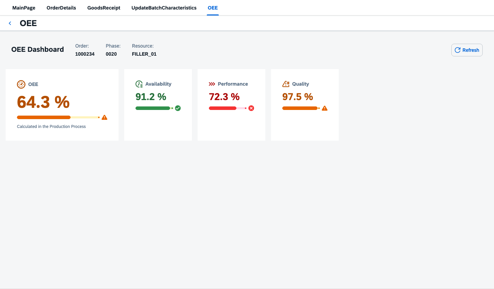
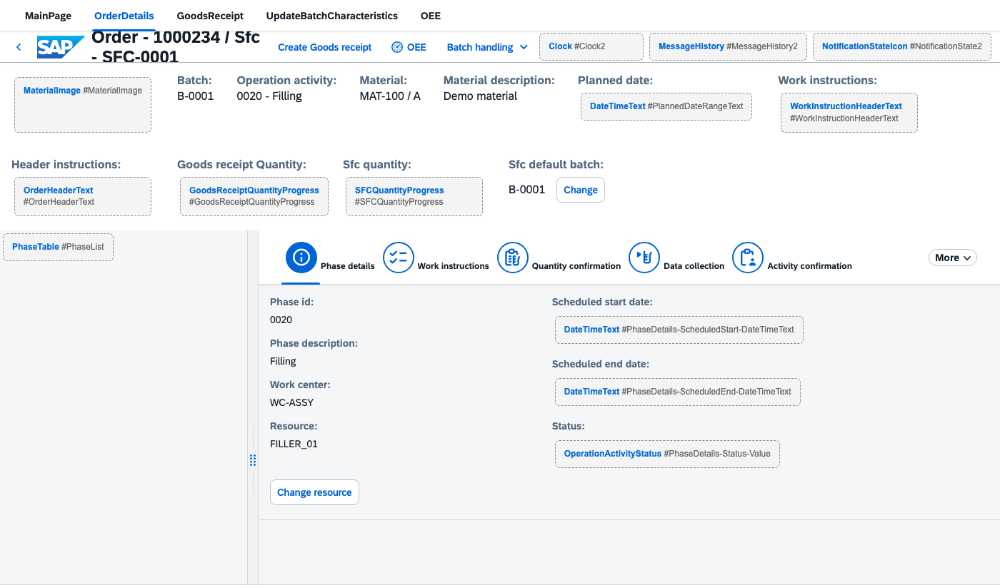

# pod2-config: a Joule Desktop skill for SAP DM POD 2.0 configuration

Configure **SAP Digital Manufacturing POD 2.0** (*Manage PODs 2.0*) by describing what you want. The skill turns a request like *"add an OEE tab fed by this Production Process"* into a complete POD export, ready for **Manage PODs 2.0 → Import**.

It is built as a **Joule Desktop** skill. Because it uses the open `SKILL.md` format with plain Node.js scripts, it runs just as well in **Claude Code** and other agents that load skills.


*A new OEE page built from scratch: 46 widgets, 20 expression bindings, a Production Process that runs on page enter, and a Refresh button. Validator errors before and after: 0 → 0.*

## Why: stay in standard

Most POD requirements end in one of two places: hours of clicking in the designer, or a custom plugin that someone has to build, deploy and maintain through every DM release.

This skill takes neither route. **No development happens.** Everything it generates is standard POD 2.0 configuration:

- only **standard SAP plugins and actions**, limited to classes verified from real exports (anything unverified is flagged);
- standard bindings and expressions on the **POD context** (`{/workList/…}`, `{/execution/…}`, `{= … }`);
- data from **Production Processes** you already model in DM, called through the standard Production Process action.

After import it is just a POD. Key users and consultants keep editing it in Manage PODs 2.0, there is no code to transport, and nothing breaks because a plugin wasn't upgraded. If a requirement really needs code, the skill says so instead of faking it.

## What you can ask for

- Add a **button, dialog, tab, page or menu** to an existing POD.
- **Show/hide or enable/disable** controls based on POD context (e.g. only with exactly one SFC selected).
- **Call a Production Process** from a button or on page/tab open, map inputs from the context, show its outputs.
- **KPI / info dashboards** (OEE, quantities, status cards) from a short spec, with threshold colours.
- A **Fiori preview** of any POD config as a single HTML file, before you import anything.

Example prompts:

```text
/pod2-config Add a "Report Scrap" button to the phase toolbar of MY_POD.json
that opens a dialog with quantity and reason, then calls PP Post_Scrap.

/pod2-config Build an OEE dashboard in tab "OEE" from PP Create_Random_Indicators_OEE
with outputs outOEE, outAvailability, outPerformance, outQuality. Preview it.
```

## Install

You need **Node.js** (any recent LTS). The scripts use only Node built-ins: no `npm install`, no dependencies. The preview needs internet (it loads SAPUI5 from the public CDN); everything else works offline.

```bash
git clone https://github.com/robertriedel/POD2_Config_Skill.git
```

- **Joule Desktop:** add the cloned folder as a skill in Joule Desktop (see the Joule Desktop documentation for where skills are configured).
- **Claude Code:** clone it straight into the skills folder, then start a new session:

  ```bash
  git clone https://github.com/robertriedel/POD2_Config_Skill.git ~/.claude/skills/pod2-config
  ```

- **Other agents:** point them at `SKILL.md`. It refers to its scripts as `~/.claude/skills/pod2-config/scripts/…`; if you install elsewhere, the agent resolves them relative to the skill folder.

## How it works

1. **Start from a real export.** Export your POD (Manage PODs 2.0 → ⋯ → Export) or start from a bundled template (`templates/`: Work Center, Operation Activity, Order).
2. **Plan first.** The agent prints a short plan (target page, new widgets, action chain, bindings, placeholders) before writing JSON, and asks only what it can't default.
3. **Patch a copy.** It writes a new file next to your export; the original is never overwritten.
4. **Validate against the baseline.** Tenant exports often carry old errors. The validator runs before and after, and the change is delivered only if it adds none.
5. **Hand over.** You import the complete POD (Manage PODs 2.0 can't import single pages), resolve the Production Process placeholders in the designer's browse dialog, then **Save** and **Run**.

## Worked example: an OEE page from scratch

Everything is in [`examples/oee/`](examples/oee/). `OEE_DEMO.json` is the SAP Order template plus an empty `OEE` page (built like the template's GoodsReceipt page) and an **OEE** button in the order details header that opens it; `add-oee-page.js` reproduces that file from `templates/ORDER_POD.json`. The spec then fills the page:

```bash
cd examples/oee
node ../../scripts/build-panel.js OEE_DEMO.json OEE_DEMO.oee.spec.json --preview
```

```text
wrote OEE_DEMO.oee.json
validator errors: baseline 0 → result 0
wrote OEE_DEMO.oee.preview.html  — open in a browser (needs internet for the SAPUI5 CDN)
```

The spec is the whole design:

```json
{
  "prefix": "OEE",
  "target": { "page": "OEE" },
  "title": "OEE Dashboard",
  "pp": { "name": "Create_Random_Indicators_OEE",
          "inputs": [ { "parameter": "inResource",
                        "value": "{/execution/operationActivity/lastSelected/resource}" } ] },
  "context": [ { "label": "Order",    "path": "/workList/lastSelected/order" },
               { "label": "Phase",    "path": "/execution/operationActivity/lastSelected/operationActivity" },
               { "label": "Resource", "path": "/execution/operationActivity/lastSelected/resource" } ],
  "fields": [
    { "source": "pp:outOEE", "label": "OEE", "scale": "percent", "thresholds": [60, 85],
      "hero": true, "icon": "sap-icon://performance", "caption": "Calculated in the Production Process" },
    { "source": "pp:outAvailability", "label": "Availability", "scale": "percent", "thresholds": [80, 90], "icon": "sap-icon://time-entry-request" },
    { "source": "pp:outPerformance",  "label": "Performance",  "scale": "percent", "thresholds": [80, 95], "icon": "sap-icon://process" },
    { "source": "pp:outQuality",      "label": "Quality",      "scale": "percent", "thresholds": [95, 99], "icon": "sap-icon://quality-issue" }
  ]
}
```

**Page enter.** Because the spec targets a page, the data load is wired to the page's own `pageEnter` event: `OEE_Busy` (BusyIndicator) → `OEE_LoadData` (Production Process call, output stored in the POD variable `_oee`). The tiles bind to `/_oee/…`, so they fill as soon as the page opens; until then they show "–". Refresh re-runs the same chain. A tab target uses `tabEnter` the same way.



The output is only stored when the Production Process action runs synchronously; check its call type once in the designer after import. Thresholds are set per KPI (OEE 60/85, Availability 80/90, Performance 80/95, Quality 95/99), and the POD calculates nothing itself: all four values come from the PP.

Re-running with the same prefix replaces the panel in place, so changing thresholds or tiles is a spec edit.

`Create_Random_Indicators_OEE` stands in for your own Production Process: any PP that returns the same output names works without changing the POD side.

**Your OEE, your formula.** Plants rarely agree with a one-size-fits-all OEE calculation: what counts as planned downtime, which ideal cycle time to use, whether rework is good quantity. Because the calculation lives in the Production Process, you implement exactly the plant's definition there. The POD dashboard doesn't change, and it all stays standard configuration.

**Spec reference** (full format in [`references/patterns.md`](references/patterns.md) §18):

| Key | Meaning |
|---|---|
| `target` | `{ "tab": "<text or id>" }`, `{ "page": "Id" }`, `{ "dialog": "Id" }` or `{ "node": "Id", "aggregation": "items" }` |
| `pp` | Production Process name and inputs (`value` binding or `variable`). Omit for a context-only panel. |
| `context` | Label/path pairs shown in the panel header |
| `fields[].source` | `pp:<output>` or any POD context path |
| `scale` | `percent` (0–100) or `fraction` (0–1, shown ×100) |
| `thresholds` | `[low, high]` on the display scale: red below low, orange below high, green at or above high |
| `lowerIsBetter` | Inverts the colours (scrap, downtime) |
| `type` | `number` (default), `string` or `boolean` (`trueText`/`falseText`, `trueIsBad`) |
| `hero`, `icon`, `caption`, `unit`, `decimals` | Presentation |

> **Import gotcha:** the generator writes `<POD_ID>.<prefix>.json`. The Manage PODs 2.0 file picker rejects names with extra dots, so import a copy named `<POD_ID>_<PREFIX>.json`.

## Scripts

All scripts are standalone Node.js files in `scripts/`.

| Script | Purpose |
|---|---|
| `build-panel.js <export> <spec> [-o out.json] [--preview]` | Spec → dashboard panel in a copy of the export, PP load chain on tab/page enter plus Refresh, validated against the baseline. `--self-test` available. |
| `preview-pod.js <export> [-o out.html]` | Self-contained Fiori preview: real SAPUI5 controls against a mock POD context, so bindings and expressions resolve. Custom plugins show as placeholders. `--self-test` available. |
| `validate-pod.js <file> [--i18n references/i18n-keys.txt]` | Structural lint: JSON, widget namespaces, legal aggregation names, dangling page/dialog references, leftover placeholders. Exit code 1 on errors. |

## Guardrails

- **Standard only.** Widget and action classes come from `references/widgets.md` / `actions.md`, verified against real exports. Anything unverified is flagged, and you're asked to configure it once in the designer and paste the JSON back.
- **No tenant data invented.** Production Process IDs, keys and hosts become `REPLACE_WITH_PP_ID_*`, `REG_REPLACE_WITH_PP_KEY_*` and `REPLACE_WITH_TENANT`, resolved in the designer.
- **Unique, readable IDs.** New nodes follow the naming of their siblings or a prefix (`OEE_Availability_Value`), so you find them in the designer and re-runs replace them cleanly. Copied subtrees are re-ID'd.
- **Complete exports only**, never a fragment you can't import.

## Repository map

```
SKILL.md                    instructions the agent follows
references/
  json-grammar.md           export shape, node shape, container → aggregation map
  binding-and-context.md    binding forms, {= } cheat sheet, PP input mapping, i18n
  pod-context.md            runtime POD context schema: what every {/…} can point to
  widgets.md                standard widget classes, property keys, table columns
  actions.md                action classes, chain semantics, Production Process shape
  patterns.md               18 recipes, incl. §18 dashboard spec format
  sap-catalog.md            the 147 SAP POD 2.0 plugins/actions with IDs and help links
  sources.md                sources and how to re-harvest them
  i18n-keys.txt             the only keys allowed in {i18n>…} labels
scripts/                    build-panel.js · preview-pod.js · validate-pod.js
templates/                  SAP-generated Work Center / Operation Activity / Order exports;
                            PALETTE.json = every designer widget dropped once (class reference)
examples/oee/               OEE page from scratch: base POD, generator script for it, spec
docs/img/                   screenshots
```

## Limits

- No tenant calls: the skill works on files, you import.
- It wires PODs to Production Processes; it doesn't design them.
- Dialog and container targets have no verified enter event, so dashboards there load via the Refresh button.
- The preview is a layout check with sample values, not a functional test.

## License

[MIT](LICENSE) © 2026 Robert Riedel. The bundled `templates/` are SAP-generated POD exports, included as reference starting points.

## Disclaimer

Community project, not an official SAP product and not supported by SAP. SAP, SAP Digital Manufacturing and Joule are trademarks of SAP SE. Always review generated configuration before importing it into a productive tenant.
